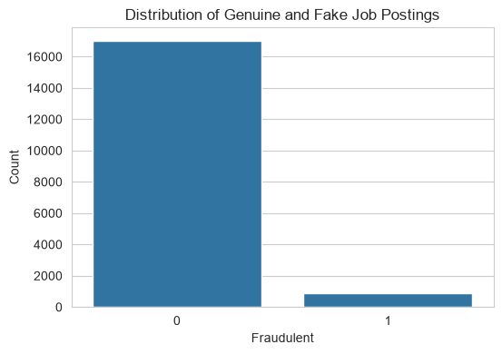
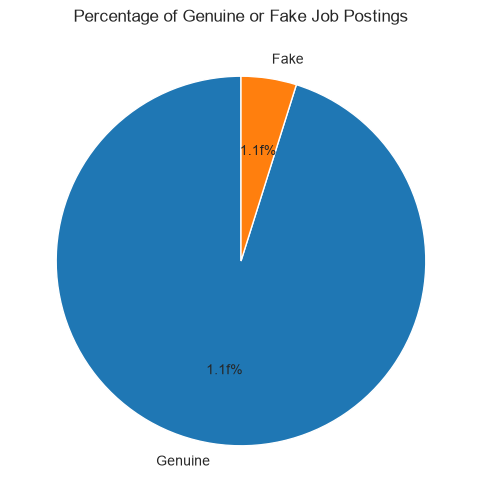
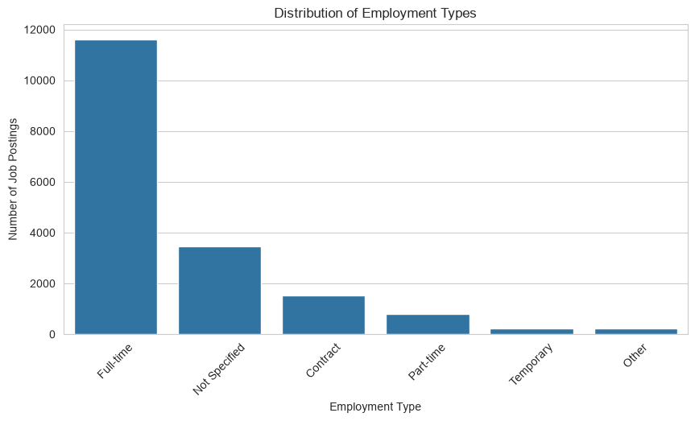
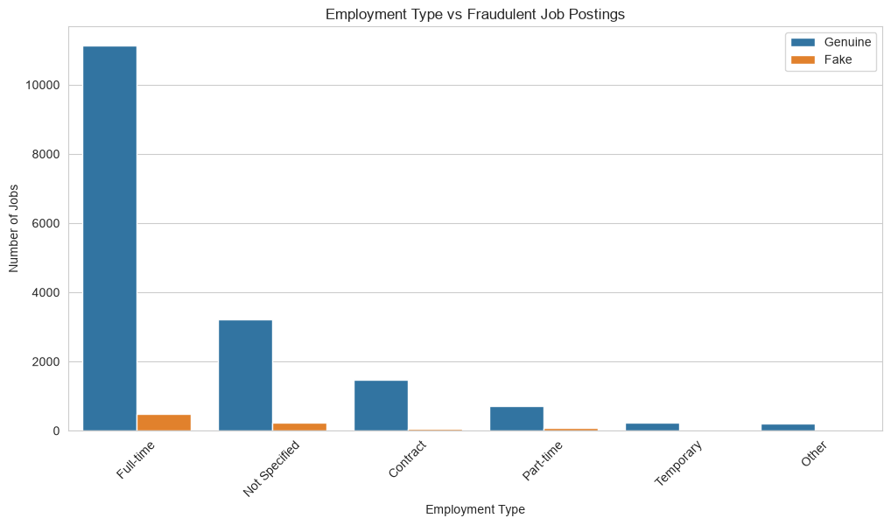
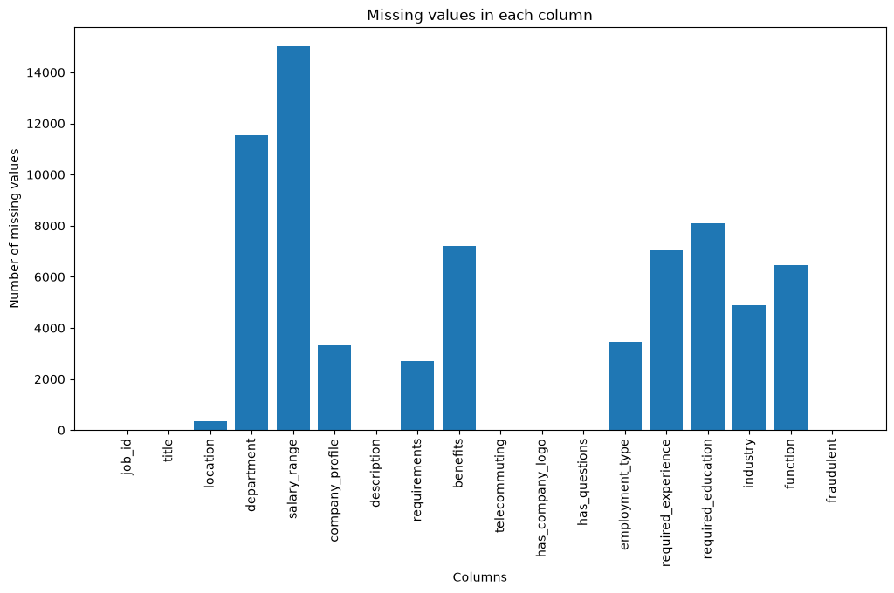
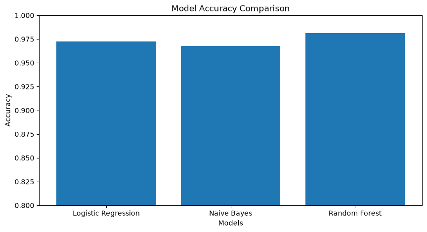
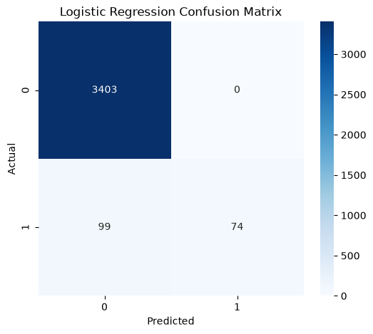
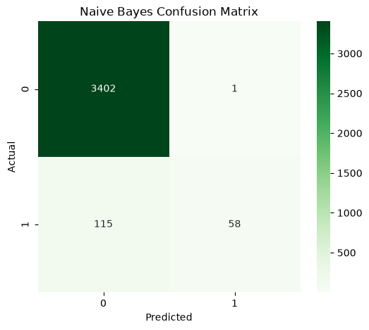
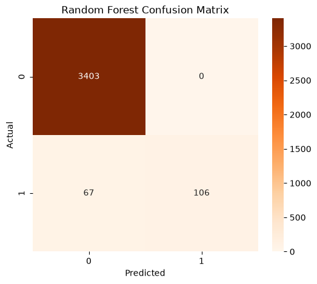
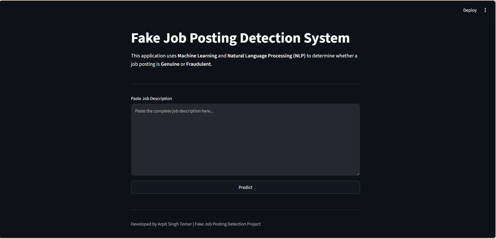

# 💼 Fake Job Posting Detection using Machine Learning & NLP

<p align="center">


</p>

---

## 📌 Project Overview

Every year, thousands of fake job advertisements are posted online to scam job seekers by collecting personal information or money.

This project presents an **AI-powered Fake Job Posting Detection System** that automatically classifies a job posting as **Genuine** or **Fraudulent** using **Natural Language Processing (NLP)** and **Machine Learning**.

The system analyzes textual information from job postings such as:

- Job Title
- Company Profile
- Job Description
- Requirements
- Benefits

After preprocessing the text, it is transformed into numerical features using **TF-IDF Vectorization**, and multiple Machine Learning algorithms are trained and compared to identify the best-performing model.

Finally, the trained model is deployed through:

- 🖥 Command Line Application (`app.py`)
- 🌐 Interactive Streamlit Web Application (`streamlit_app.py`)

---

# 🎯 Objectives

The primary objectives of this project are:

- Detect fraudulent job advertisements using Machine Learning.
- Perform extensive Exploratory Data Analysis (EDA).
- Clean and preprocess textual data.
- Convert text into numerical vectors using TF-IDF.
- Train multiple classification models.
- Compare model performance using different evaluation metrics.
- Build a prediction system for unseen job postings.
- Deploy the model with an interactive web interface.

---

# ✨ Key Features

- 📊 Complete Exploratory Data Analysis (EDA)
- 🧹 Advanced Text Preprocessing
- 🔤 TF-IDF Feature Engineering
- 🤖 Multiple Machine Learning Models
- 📈 Model Comparison
- 🎯 Fraud Prediction System
- 🌐 Streamlit Web Application
- 💻 Command Line Application
- 📁 Well-Organized Project Structure
- 📚 Easy-to-Understand Jupyter Notebooks

---

# 🛠 Technologies Used

| Category | Technologies |
|----------|--------------|
| Programming Language | Python |
| Data Analysis | Pandas, NumPy |
| Data Visualization | Matplotlib, Seaborn |
| NLP | NLTK |
| Feature Engineering | TF-IDF Vectorizer |
| Machine Learning | Scikit-Learn |
| Model Serialization | Joblib |
| Web Framework | Streamlit |
| Development Environment | Jupyter Notebook, VS Code |

---

# 📂 Project Structure

```text
Fake Job Posting Detection/
├──.venv
│
├── data/
│   ├── cleaned_fake_job_postings.csv
│   ├── fake_job_postings.csv
│   ├── processed_fake_job_postings.csv
│   ├── X_test.npz
│   ├── X_train.npz
│   ├── y_test.csv
│   └── y_train.csv
│
├── images/
│   ├── Distribution_of_Employment_Types.png
│   ├── Distribution_of_Genuine_and_Fake_Job_Postings.png
│   ├── Employment_Type_vs_Fraudulent_Job_Postings.png
│   ├── Logistic_Regression_Confusion_Matrix.png
│   ├── missing_values.png
│   ├── Model_Accuracy_Comparison.png
│   ├── Naive_Bayes_Confusion_Matrix.png
│   ├── Percentage_of_Genuine_or_Fake_Job_Postings.png
│   ├── Random_Forest_Confusion_Matrix.png
│   └── Streamlit_app.png
│
├── models/
│   ├── logistic_regression.pkl
│   ├── naive_bayes.pkl
│   ├── random_forest.pkl
│   └── tfidf_vectorizer.pkl
│
├── notebooks/
│   ├── Data_Loading_and_Cleaning.ipynb
│   ├── Exploratory_Data_Analysis.ipynb
│   ├── Feature_Engineering_TFIDF.ipynb
│   ├── Model_Evaluation.ipynb
│   ├── Model_Training.ipynb
│   ├── Prediction_System.ipynb
│   └── Text_Preprocessing.ipynb
│
├── Output Videos/
│   ├── app.py(CLI Version).mp4
│   ├── Data_Loading.mp4
│   ├── EDA.mp4
│   ├── Feature_Extraction.mp4
│   ├── Model_Evaluation.mp4
│   ├── Model_Training.mp4
│   ├── Prediction_System.mp4
│   ├── Streamlit app(Web Version).mp4
│   └── Text_Preprocessing.mp4
│
├── .gitignore
├── app.py
├── README.md
├── requirements.txt
└── streamlit_app.py
```

---

# 🔄 Machine Learning Workflow

```text
Raw Dataset
      │
      ▼
Data Cleaning
      │
      ▼
Exploratory Data Analysis (EDA)
      │
      ▼
Text Preprocessing
      │
      ▼
TF-IDF Feature Engineering
      │
      ▼
Train-Test Split
      │
      ▼
Model Training
      │
      ▼
Model Evaluation
      │
      ▼
Best Model Selection
      │
      ▼
Prediction System
      │
      ▼
Streamlit Deployment
```

---

# 📊 Dataset Information

The dataset contains both structured and unstructured information related to job postings.

Important features include:

- Title
- Company Profile
- Description
- Requirements
- Benefits
- Employment Type
- Required Experience
- Required Education
- Industry
- Function
- Fraudulent (Target Variable)

Target Variable:

- **0 → Genuine Job Posting**
- **1 → Fraudulent Job Posting**

---

# 📈 Exploratory Data Analysis (EDA)

Before training the models, an in-depth Exploratory Data Analysis (EDA) was performed to understand the dataset and identify meaningful patterns.

The following analyses were carried out:

- Distribution of Genuine vs Fraudulent Job Postings
- Employment Type Distribution
- Required Experience Distribution
- Required Education Distribution
- Industry-wise Distribution
- Function-wise Distribution
- Missing Value Analysis
- Text Length Distribution
- Correlation Analysis (Numerical Features)


---

## 📌 Distribution_of_Genuine_and_Fake_Job_Postings

<p align="center">
    
</p>

This chart highlights the imbalance between genuine and fraudulent job postings in the dataset.

---

## 📌 2. Percentage of Genuine or Fake Job Postings

<p align="center">
    
</p>

A pie chart representing the percentage share of genuine and fraudulent job advertisements.

---

## 📌 3. Distribution of Employment Types

<p align="center">
    
</p>

This visualization shows the frequency of different employment categories such as Full-time, Contract, Part-time, Temporary, and Others.

---

## 📌 4. Employment Type vs Fraudulent Job Postings

<p align="center">
    
</p>

Comparison of genuine and fraudulent job postings across different employment types.

---

## 📌 5. Missing Values Analysis

<p align="center">
    
</p>

This graph illustrates the number of missing values present in each feature before preprocessing.

---

# 🤖 Machine Learning Model Evaluation

Three machine learning algorithms were trained and evaluated on the dataset:

- Logistic Regression
- Naive Bayes
- Random Forest

---

## 📌 6. Model Accuracy Comparison

<p align="center">
    
</p>

Comparison of overall accuracy achieved by each machine learning model.

---

## 📌 7. Logistic Regression Confusion Matrix

<p align="center">
    
</p>

Confusion Matrix for the Logistic Regression model showing prediction performance.

---

## 📌 8. Naive Bayes Confusion Matrix

<p align="center">
    
</p>

Confusion Matrix for the Naive Bayes classifier.

---

## 📌 9. Random Forest Confusion Matrix

<p align="center">
    
</p>

Confusion Matrix for the Random Forest model, which achieved the best overall performance among all evaluated models.

---
---

# 🧹 Text Preprocessing Pipeline

Natural Language Processing (NLP) techniques were applied to clean and standardize the textual data before feature extraction.

The preprocessing pipeline included:

- Convert text to lowercase
- Remove URLs
- Remove numbers
- Remove punctuation
- Remove extra whitespace
- Tokenization
- Stopword Removal
- Lemmatization

### Example

**Original Text**

```text
Google is Hiring Software Engineers!
Apply at https://careers.google.com
```

↓

**Processed Text**

```text
google hiring software engineer apply
```

---

# 🔤 Feature Engineering

Text data cannot be directly processed by Machine Learning algorithms.

Therefore, the cleaned text was transformed into numerical vectors using the **TF-IDF (Term Frequency–Inverse Document Frequency)** technique.

### Why TF-IDF?

- Assigns higher importance to informative words.
- Reduces the impact of common words.
- Produces sparse numerical vectors suitable for text classification.

---

# 🤖 Machine Learning Models

Three different Machine Learning algorithms were trained and compared.

| Model | Purpose |
|--------|----------|
| Logistic Regression | Linear classifier for high-dimensional text data |
| Multinomial Naive Bayes | Probabilistic classifier optimized for word frequencies |
| Random Forest | Ensemble model for comparison |

Each model was trained using the same TF-IDF features and evaluated on the same test dataset.

---

# 📊 Model Evaluation

The models were evaluated using multiple performance metrics instead of relying only on accuracy.

Evaluation metrics:

- Accuracy
- Precision
- Recall
- F1-Score
- Confusion Matrix
- Classification Report

### Model Comparison

| Model | Accuracy | Precision | Recall | F1 Score |
|--------|----------|-----------|--------|----------|
| Logistic Regression | *0.972315* | *1.000000* | *0.427746* | *0.599190* |
| Naive Bayes | *0.967562* | *0.983051* | *0.335260* | *0.500000* |
| Random Forest | *0.981264* | *1.000000* | *0.612717* | *0.759857* |


---

# 🏆 Best Performing Model

Based on the evaluation results, the selected model for deployment was:

**✅ Random Forest with TF-IDF Vectorizer**

### Why?

- Excellent performance on sparse text features
- Fast prediction speed
- High accuracy and F1-score
- Computationally efficient
- Well suited for Natural Language Processing tasks

---

# 💻 Command Line Application

Run the CLI version:

```bash
python app.py
```

The application accepts a job description and predicts whether it is:

- ✅ Genuine
- ❌ Fraudulent

---

# 🌐 Streamlit Web Application

Run the web application:

```bash
streamlit run streamlit_app.py
```

The Streamlit app provides:

- Interactive web interface
- Job description text area
- Predict button
- Prediction result
- Confidence scores
- Easy-to-use interface for non-technical users

---

# ⚙️ Installation Guide

## 1. Clone the Repository

```bash
git clone https://github.com/Apxsingh/Fake-Job_Posting-Prediction_System-Using-Machine_Learning.git
```

---

## 2. Navigate to the Project Folder

```bash
cd Fake-Job_Posting-Prediction_System-Using-Machine_Learning```

---

## 3. Create a Virtual Environment

### Windows

```bash
python -m venv .venv
```

Activate:

```bash
.venv\Scripts\activate
```

---

### Linux / macOS

```bash
python3 -m venv .venv
source .venv/bin/activate
```

---

## 4. Install Dependencies

```bash
pip install -r requirements.txt
```

---

## 5. Run the Streamlit Application

```bash
streamlit run streamlit_app.py
```

---

## 6. Run the Command Line Application

```bash
python app.py
```

---

# 📷 Project Screenshots

Create an `images/` folder in your repository and add screenshots such as:

- Dataset Overview
- EDA Visualizations
- Model Evaluation
- Streamlit Application
- Command Line Prediction

Example:


## Streamlit Application

<p align="center">
    
</p>
```

---

# 🚀 Future Improvements

Potential enhancements for this project include:

- Deep Learning models (LSTM, GRU)
- Transformer-based models (BERT, RoBERTa)
- Explainable AI (SHAP, LIME)
- Real-time web scraping of job postings
- REST API deployment using FastAPI
- Docker containerization
- Cloud deployment (AWS, Azure, Render)

---

# 🧪 Testing Examples

### Example 1 — Fraudulent Job Posting

**Input**

```text
Urgently Hiring!

Work From Home

Earn $5000 Per Week

No Experience Required

Apply Immediately

Click On The Link Below.
```

**Prediction**

```text
❌ Fraudulent Job Posting
```

---

### Example 2 — Genuine Job Posting

**Input**

```text
Google is hiring Software Engineers.

Bachelor's Degree Required.

Medical Insurance.

Hybrid Work.

Annual Bonus.

Apply through the official careers website.
```

**Prediction**

```text
✅ Genuine Job Posting
```

---

# 📚 Skills Demonstrated

This project demonstrates practical experience in:

- Python Programming
- Data Cleaning
- Exploratory Data Analysis (EDA)
- Natural Language Processing (NLP)
- Text Preprocessing
- Feature Engineering
- TF-IDF Vectorization
- Machine Learning Classification
- Model Evaluation
- Model Deployment
- Streamlit Development
- Git & GitHub
- Documentation

---

# 📖 What I Learned

During this project, I gained hands-on experience in:

- Working with real-world datasets
- Handling missing values
- Text preprocessing techniques
- Feature engineering using TF-IDF
- Training multiple machine learning models
- Comparing model performance
- Deploying machine learning applications
- Building interactive web applications using Streamlit
- Creating production-ready project structures
- Version control using Git and GitHub

---

# 🎯 Internship Project

This project was developed as part of my **Artificial Intelligence / Machine Learning Internship**.

The objective was to build a complete end-to-end machine learning solution capable of detecting fraudulent job postings using Natural Language Processing techniques and multiple classification algorithms.

The project covers the entire machine learning lifecycle from data preprocessing to deployment.

---

# 🙏 Acknowledgements

Special thanks to:

- 3Skill
- Scikit-Learn Documentation
- Streamlit Documentation
- NLTK Documentation
- Kaggle Community
- Open Source Community

---

# 📜 License

This project is licensed under the **MIT License**.

You are free to use, modify, and distribute this project for educational purposes.

---

# 👨‍💻 Author

## Arpit Singh Tomar

AI & Machine Learning Enthusiast

Passionate about building intelligent systems using Machine Learning, Natural Language Processing, and Data Science.

### Connect with Me

- 💼 LinkedIn : https://www.linkedin.com/in/arpitsinghtomar/
- 💻 GitHub : https://github.com/Apxsingh
- 📧 Email : singhtomararpit2@gmail.com

---

# ⭐ Support

If you found this project useful:

⭐ Star this repository

🍴 Fork the repository

🛠️ Contribute with improvements

📢 Share it with others

Your support is greatly appreciated!

---


# 📊 Repository Statistics

**Project Type**

Machine Learning • NLP • Binary Classification

**Status**

✅ Completed

**Language**

Python

**Framework**

Scikit-Learn

**Deployment**

Streamlit

**Dataset**

Fake Job Postings Dataset

---

<p align="center">

## ⭐ If you like this project, don't forget to star the repository! ⭐

Made with ❤️ using Python, Machine Learning, NLP, and Streamlit.

</p>